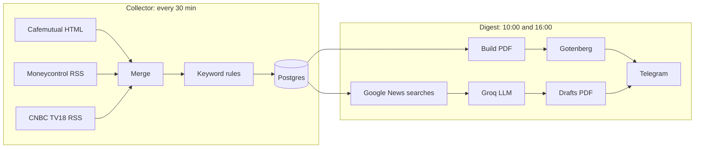

# Market Digest

A self-hosted n8n automation that collects Indian finance news, sorts it into categories, and posts a PDF digest to a Telegram group twice a day. Each morning it also drafts five debate-style X (Twitter) posts for a social media team.

Runs on Docker Compose: **n8n + Postgres + Gotenberg**. Free to run: the LLM step uses Groq's free tier.

## What it does

- **Collects** every 30 minutes from Cafemutual (HTML), Moneycontrol (RSS) and CNBC TV18 (RSS).
- **Categorises** each headline with keyword rules stored in Postgres: SEBI & AMFI, Insurance, Global News, US Market, Indian Market, MF Industry.
- **Sends a PDF digest** to Telegram at 10:00 and 16:00 IST, capped at 8 headlines per category with sources mixed.
- **Drafts 5 X posts** (a hot take and a poll per topic) from the most debatable stories of the day, using today's headlines plus Google News searches, and sends them as a PDF.



## Setup

**Requirements:** Docker Desktop (or Docker + Compose), a Telegram bot from [@BotFather](https://t.me/BotFather), and a free [Groq API key](https://console.groq.com/keys).

1. **Configure**
   ```bash
   cp .env.example .env
   # set POSTGRES_PASSWORD and N8N_ENCRYPTION_KEY (openssl rand -hex 32)
   ```
2. **Start**
   ```bash
   docker compose up -d
   ```
   `init/init.sql` creates the `digest` database and keyword rules on the first start.
3. **Open n8n** at `http://localhost:5679`, create the owner account, and import both files from `workflows/`.
4. **Add credentials** in n8n:
   - **Postgres:** host `postgres`, database `digest`, user and password from `.env`
   - **Telegram:** your bot token
   - **Groq API:** your key, without a `Bearer` prefix
5. **Set chat IDs** at the top of the *Build Digest* node: `TEST_CHAT` (your private chat) and `GROUP_CHAT` (the group, usually starting `-100`).
6. **Test.** Run the collector once, then run the digest from the **Test (send to me)** trigger. Test runs go only to your private chat and mark nothing as sent.
7. **Activate** both workflows.

## Running it

| Trigger | Goes to | Marks articles sent |
|---|---|---|
| Test (send to me) | Your private chat, labelled [TEST] | No |
| 10:00 and 16:00 schedule | Group | Yes |
| 10:00 and 16:00, run by hand | Group, immediately | Yes |

**Keyword rules** live in the `category_rules` table, and the lowest priority number wins. To add one:
```bash
docker compose exec postgres psql -U digest -d digest -c \
  "INSERT INTO category_rules (priority, category, pattern, case_sensitive) VALUES (5, 'Indian Market', '\b(IPOs?)\b', FALSE);"
```
To see headlines that matched no rule:
```bash
docker compose exec postgres psql -U digest -d digest -c \
  "SELECT title FROM articles WHERE category='uncategorised' ORDER BY fetched_at DESC LIMIT 30;"
```

**Settings** are at the top of the Code nodes: categories and per-category cap in *Build Digest*, Google News searches in *Debate Queries*, and the number of topics and writing style in *Pick Draft Topic*.

## Troubleshooting

- **`self-signed certificate in certificate chain` calling Groq.** Some networks intercept the IPv6 route. The compose file sets `NODE_OPTIONS=--dns-result-order=ipv4first` to avoid it.
- **`model ... does not exist`.** Choose a current model from [Groq's model list](https://console.groq.com/docs/models) in the *Groq Model* node (default `openai/gpt-oss-120b`).
- **`chat not found`.** The bot isn't in the group, or the group was upgraded to a supergroup and got a new `-100...` ID. Fetch it again from `https://api.telegram.org/bot<TOKEN>/getUpdates`.
- **Moneycontrol HTML pages return 403.** That's why Moneycontrol is read through RSS.
- **n8n's Code node has no `URL` global.** The extraction code resolves links by hand.

## Notes

- The digest contains **headlines and links only**. Respect each source's terms, and don't republish full articles.
- X drafts are AI-generated, for **human review before posting**. The prompt forbids investment advice, invented facts, and attacks on individuals.
- Google News RSS is intended for personal, non-commercial use.
- Data lives in Docker volumes. Back up with `docker compose exec postgres pg_dumpall -U digest > backup.sql`, and keep `.env` alongside it.
